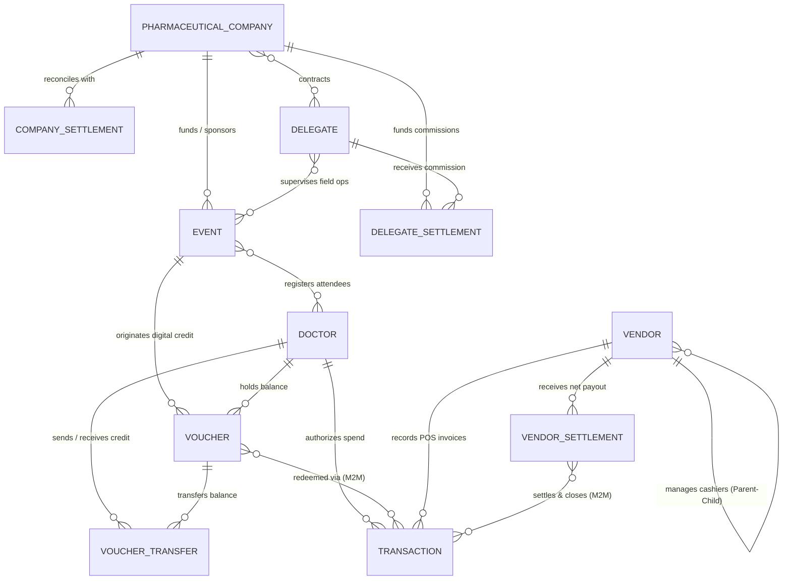
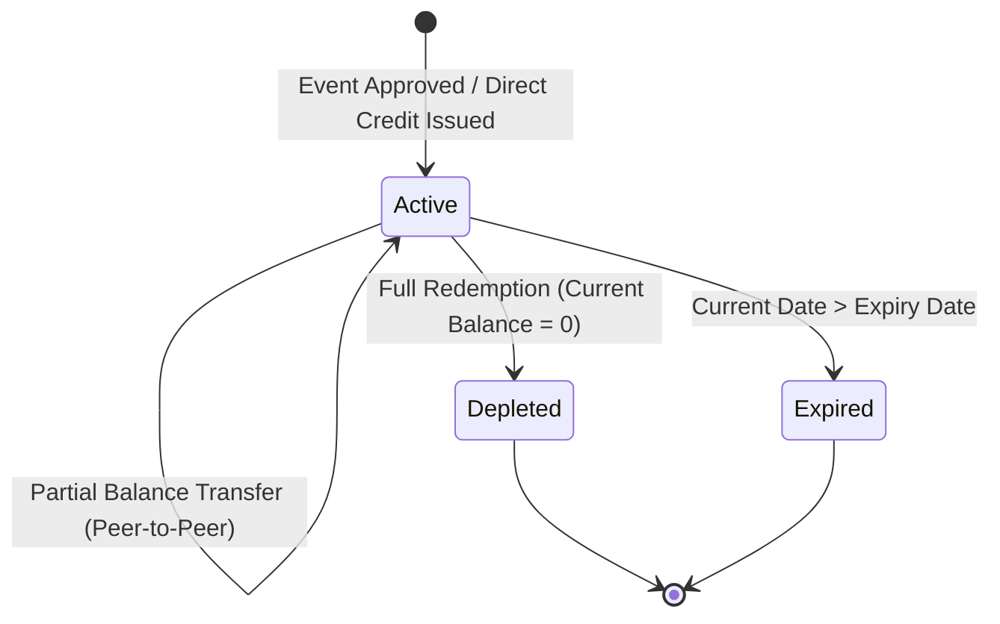
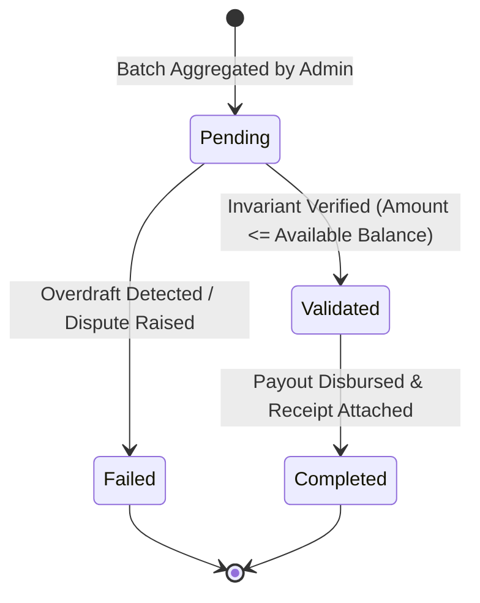
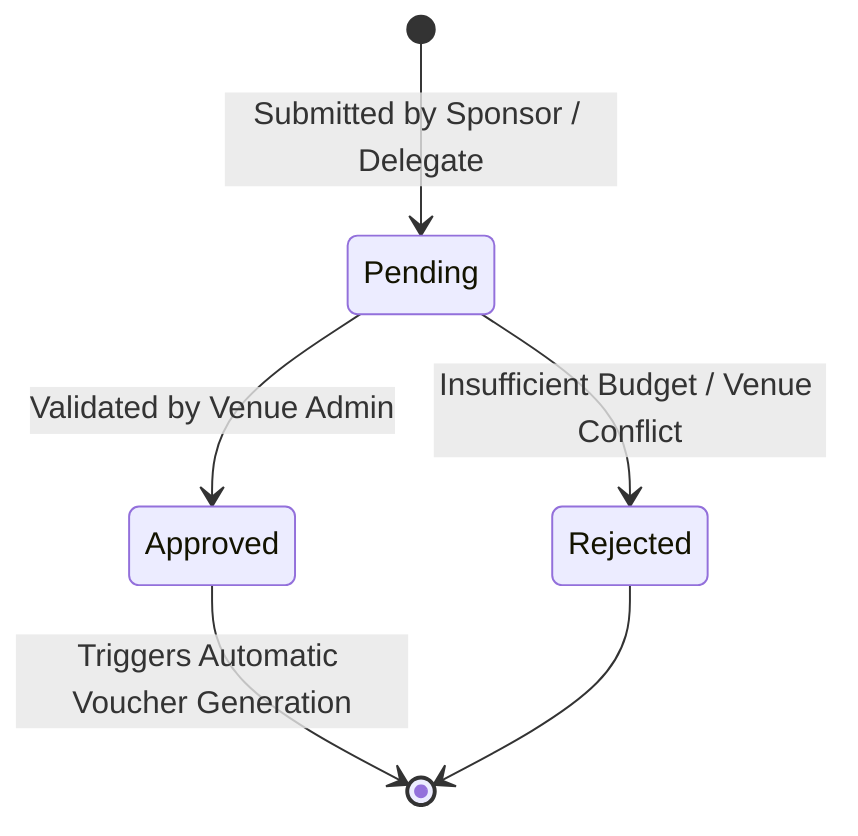

# Entity Relationship Diagram (ERD) & Data Model Specification

This document provides a comprehensive technical reference for the data model, entity relationships, attribute schemas, and state machines governing the **Vaetcher** platform. 

The architecture is designed to enforce strict transactional consistency across pre-funded corporate voucher balances, multi-merchant dining redemptions, dynamic administrative markups, and three independent financial settlement lifecycles.

---

## 1. High-Level Entity Relationship Diagram

The following Mermaid diagram visualizes the relational schema, foreign key associations, and many-to-many junction relationships between all core business entities.

---

## 2. Detailed Entity Data Dictionary

Below is the comprehensive data dictionary detailing each entity's attributes, logical data types, nullability, constraints, and business domain responsibilities.

### 2.1. User Account & Identity (`USER`)
Serves as the root identity entity supporting multi-role authentication.
- **`user_type`** *(Enumeration, Required)*: Discriminator defining operational dashboard scope: `ADMIN`, `VENDOR`, `COMPANY`, `DELEGATE`, `DOCTOR`.
- **`phone`** *(String, Unique, Nullable)*: Primary mobile contact used for authentication and POS directory lookups.
- **`email`** *(Email Address, Unique, Nullable)*: Required for digital notifications and high-security OTP verification.

---

### 2.2. Pharmaceutical Company (`COMPANY`)
Represents the corporate entity funding medical educational symposia.
- **`name`** *(String, Unique, Required)*: Corporate registered trading name.
- **`contact_person`** *(String, Required)*: Corporate liaison responsible for event contracting.
- **`phone`** *(String, Required)*: Primary corporate business telephone.
- **`email`** *(Email Address, Required)*: Corporate billing and notification address.
- **`address`** *(Text, Required)*: Corporate headquarters billing address.
- **`is_deleted`** *(Boolean, Default: False)*: Soft-delete audit flag preserving historical financial integrity.

---

### 2.3. Medical Sales Representative (`DELEGATE`)
Represents the field representative executing seminar arrangements on behalf of pharmaceutical sponsors.
- **`name`** *(String, Required)*: Representative full legal name.
- **`phone`** *(String, Unique, Required)*: Unique direct contact number.
- **`companies`** *(Many-to-Many with Company)*: Connects a representative to one or more authorized corporate sponsors.
- **`is_deleted`** *(Boolean, Default: False)*: Soft-delete flag preserving historical event coordination logs.

---

### 2.4. Physician (`DOCTOR`)
Represents the beneficiary of continuing medical education hospitality allowances.
- **`name`** *(String, Required)*: Physician full professional name.
- **`phone`** *(String, Unique, Required)*: Mobile number used for POS directory verification.
- **`email`** *(Email Address, Unique, Required)*: Verified email destination for POS One-Time Passwords (OTP).
- **`qr_code`** *(String, Unique, Required)*: Cryptographically generated alphanumeric token mapped to the physician's digital QR pass.
- **`profile_picture`** *(Image/URI, Nullable)*: Visual portrait displayed during POS lookup to prevent impersonation.
- **`is_deleted`** *(Boolean, Default: False)*: Soft-delete audit flag preserving transaction history.

---

### 2.5. Hospitality Venue & Partner Merchant (`VENDOR`)
Represents dining establishments authorized to redeem digital vouchers.
- **`name`** *(String, Unique, Required)*: Merchant establishment or branch name.
- **`contact_person`** *(String, Required)*: Store manager or operations director.
- **`phone`** *(String, Required)*: Direct telephone for branch operations.
- **`email`** *(Email Address, Required)*: Branch management email.
- **`address`** *(Text, Required)*: Physical venue location.
- **`category`** *(String, Required)*: Venue classification (e.g., Restaurant, Cafe).
- **`role`** *(Enumeration: `ADMIN`, `CASHIER`)*: Distinguishes merchant managerial accounts from register-only terminals.
- **`parent_vendor`** *(Self Foreign Key, Nullable)*: Hierarchical pointer linking Cashier terminals to their parent merchant establishment.
- **`management_fee_percentage`** *(Decimal, Required, Default: 25.00%)*: Dynamic administrative markup percentage charged by the venue when vouchers are redeemed at partner premises.
- **`has_management_fee`** *(Boolean, Default: True)*: Boolean toggle determining whether markups are assessed.
- **`bank_info`** *(Text, Nullable)*: Commercial banking details for settlement disbursements.
- **`wallet_info`** *(Text, Nullable)*: Electronic wallet details (e.g., mobile cash) for immediate disbursements.
- **`is_active`** *(Boolean, Default: True)*: Merchant operational status toggle.
- **`is_deleted`** *(Boolean, Default: False)*: Soft-delete audit flag.

---

### 2.6. Scientific Seminar (`EVENT`)
Represents a sponsored medical symposium or corporate dining agreement.
- **`name`** *(String, Required)*: Seminar title or conference identifier.
- **`date`** *(Date, Required)*: Calendar date of the event.
- **`company`** *(Foreign Key to Company, Required)*: Corporate sponsor funding the seminar.
- **`payment_type`** *(Enumeration: `CASH`, `DEFERRED`)*: Sponsor settlement terms (advance payment vs. credit settlement).
- **`voucher_value`** *(Decimal, Required)*: Face value allocated to each attending physician.
- **`voucher_expiry_days`** *(Integer, Required, Default: 90)*: Temporal validity window granted to generated vouchers.
- **`max_budget`** *(Decimal, Required)*: Global financial ceiling approved for the seminar.
- **`doctors`** *(Many-to-Many with Doctor)*: Roster of invited attending physicians.
- **`delegates`** *(Many-to-Many with Delegate)*: Field representatives managing event execution.

---

### 2.7. Digital Voucher (`VOUCHER`)
Represents an individual digital pre-funded credit balance allocated to a physician.
- **`doctor`** *(Foreign Key to Doctor, Required)*: Legal owner of the digital credit.
- **`event`** *(Foreign Key to Event, Nullable)*: Generating seminar origin.
- **`company`** *(Foreign Key to Company, Nullable)*: Funding corporate sponsor.
- **`initial_value`** *(Decimal, Required)*: Original face value credited upon creation.
- **`current_balance`** *(Decimal, Required)*: Real-time remaining unspent credit balance.
- **`issue_date`** *(Date, Required)*: Date of digital issuance.
- **`expiry_date`** *(Date, Required)*: Hard expiration deadline after which POS redemption is rejected.
- **`is_active`** *(Boolean, Default: True)*: Administrative activation status.

---

### 2.8. Peer-to-Peer Voucher Transfer (`VOUCHER_TRANSFER`)
Represents an immutable ledger entry of credit delegation between colleagues.
- **`from_doctor`** *(Foreign Key to Doctor, Required)*: Originating physician releasing credit.
- **`to_doctor`** *(Foreign Key to Doctor, Required)*: Beneficiary physician receiving credit.
- **`voucher`** *(Foreign Key to Voucher, Required)*: Source voucher debited during transfer.
- **`transfer_date`** *(Timestamp, Required)*: Audit timestamp of the balance reallocation.

---

### 2.9. Point-of-Sale Transaction (`TRANSACTION`)
Represents a finalized dining purchase invoice processed at an authorized venue.
- **`invoice_number`** *(String, Unique, Required)*: Point-of-sale invoice or receipt reference.
- **`vendor`** *(Foreign Key to Vendor, Required)*: Venue merchant where goods/services were rendered.
- **`doctor`** *(Foreign Key to Doctor, Required)*: Physician customer redeeming credit.
- **`created_by`** *(Foreign Key to User, Required)*: Cashier staff member who validated and logged the sale.
- **`amount_spent`** *(Decimal, Required)*: Net face value of dining goods consumed.
- **`management_fee_percentage`** *(Decimal, Required)*: Snapshot of the partner markup percentage active at transaction time.
- **`management_fee_amount`** *(Decimal, Required)*: Administrative fee calculated on partner transactions.
- **`total_deducted`** *(Decimal, Required)*: Total balance debited from the physician's vouchers ($AmountSpent + ManagementFee$).
- **`transaction_date`** *(Timestamp, Required)*: Time of atomic POS settlement.
- **`items_description`** *(Text, Optional)*: Line-item summary of hospitality services provided.
- **`vouchers`** *(Many-to-Many with Voucher)*: Relational junction tracking every voucher contributing funds toward the invoice.

---

### 2.10. Triple-Tier Financial Settlements

#### A. Vendor Settlement (`VENDOR_SETTLEMENT`)
Reconciles merchant receivables against administrative markups.
- **`vendor`** *(Foreign Key to Vendor, Required)*: Partner merchant receiving payout.
- **`amount_settled`** *(Decimal, Required)*: Total gross sales volume settled in this batch.
- **`admin_commission_amount`** *(Decimal, Required)*: Total management markups retained by primary venue.
- **`net_amount_to_vendor`** *(Decimal, Required)*: Net funds disbursed to merchant ($AmountSettled - AdminCommission$).
- **`settlement_date`** *(Date, Required)*: Date of financial execution.
- **`settlement_status`** *(Enumeration: `PENDING`, `COMPLETED`, `FAILED`)*: Lifecycle execution state.
- **`payment_method`** *(Enumeration: `BANK`, `CASH`, `CHECK`)*: Disbursement channel.
- **`receipt_image`** *(Image/File, Nullable)*: Bank transfer receipt or voucher settlement sign-off slip.
- **`transactions`** *(Many-to-Many with Transaction)*: Explicit junction linking all settled POS invoices.

#### B. Company Settlement (`COMPANY_SETTLEMENT`)
Reconciles corporate sponsorship commitments against actual doctor dining consumption.
- **`company`** *(Foreign Key to Company, Required)*: Corporate pharmaceutical sponsor.
- **`total_budget_allocated`** *(Decimal, Required)*: Total agreed contractual budget cap.
- **`total_vouchers_distributed`** *(Decimal, Required)*: Cumulative face value of issued vouchers.
- **`total_amount_spent`** *(Decimal, Required)*: Actual aggregated dining spend executed by doctors.
- **`settlement_amount`** *(Decimal, Required)*: Net final invoice billed to or refunded by corporate sponsor.
- **`settlement_date`** *(Date, Required)*: Date of corporate audit sign-off.
- **`settlement_status`** *(Enumeration: `PENDING`, `PARTIAL`, `COMPLETED`)*: Reconciliation lifecycle status.
- **`receipt_image`** *(Image/File, Nullable)*: Signed corporate reconciliation memorandum.

#### C. Delegate Settlement (`DELEGATE_SETTLEMENT`)
Reconciles field representative commission remuneration.
- **`delegate`** *(Foreign Key to Delegate, Required)*: Field representative payee.
- **`company`** *(Foreign Key to Company, Required)*: Corporate sponsor funding commission.
- **`events_assigned`** *(Integer, Required)*: Count of completed seminars coordinated.
- **`doctors_registered`** *(Integer, Required)*: Total verified physicians onboarded.
- **`commission_rate`** *(Decimal, Required)*: Agreed percentage or unit commission rate.
- **`total_commission`** *(Decimal, Required)*: Computed performance remuneration.
- **`settlement_amount`** *(Decimal, Required)*: Actual disbursed payout.
- **`settlement_date`** *(Date, Required)*: Date of commission payment.
- **`settlement_status`** *(Enumeration: `PENDING`, `COMPLETED`, `DISPUTED`)*: Payout approval status.
- **`receipt_image`** *(Image/File, Nullable)*: Acknowledgment or payment confirmation slip.

---

## 3. Cardinality & Relational Junction Breakdown

| Relationship | Type | Relational Mechanics & Business Logic |
| :--- | :--- | :--- |
| **Transaction $\leftrightarrow$ Voucher** | **Many-to-Many** | A single transaction can draw funds from multiple vouchers held by a physician (waterfall deduction). Conversely, an individual voucher can fund multiple transactions until its balance reaches zero. |
| **Vendor Settlement $\leftrightarrow$ Transaction** | **Many-to-Many** | A vendor settlement aggregates multiple completed transactions for batch payment. Linking transactions explicitly guarantees that settled sales cannot be re-settled. |
| **Vendor $\leftrightarrow$ Vendor (Cashier)** | **One-to-Many (Self)** | Hierarchical merchant model: a parent merchant establishment owns multiple cashier sub-accounts that inherit merchant markup rates but have restricted POS-only permissions. |
| **Event $\leftrightarrow$ Doctor** | **Many-to-Many** | An event invites a roster of doctors. A doctor can attend multiple symposiums across the year, accumulating independent vouchers from each event. |
| **Event $\leftrightarrow$ Delegate** | **Many-to-Many** | A symposium can be managed by multiple field representatives; a delegate manages multiple regional events. |
| **Company $\leftrightarrow$ Delegate** | **Many-to-Many** | Sales representatives may contract with multiple pharmaceutical divisions or partner firms. |

---

## 4. Entity Lifecycle State Machines

### 4.1. Voucher Lifecycle State Machine

- **Active:** Voucher holds positive balance ($CurrentBalance > 0$) and current date is strictly before or on expiration date ($Today \le ExpiryDate$).
- **Depleted:** Cumulative transactions have consumed the entire initial allocation ($CurrentBalance = 0$). No further redemptions permitted.
- **Expired:** Temporal expiration threshold reached. POS engine rejects redemption even if balance remains positive.

---

### 4.2. Vendor Settlement Lifecycle State Machine

- **Pending:** Settlement record created; eligible transactions flagged for review.
- **Validated:** System confirms requested settlement amount does not exceed net accumulated unsettled sales.
- **Completed:** Payment executed via chosen channel; proof of receipt uploaded; transactions permanently locked.
- **Failed:** Aborted due to balance mismatch or merchant dispute; linked transactions released back to unsettled pool.

---

### 4.3. Event Request Lifecycle State Machine

- **Pending:** Event submitted with physician attendee roster and budget caps.
- **Approved:** Admin authorizes symposium; system automatically instantiates digital vouchers for all registered doctors.
- **Rejected:** Submission declined; no vouchers issued; sponsor notified.
