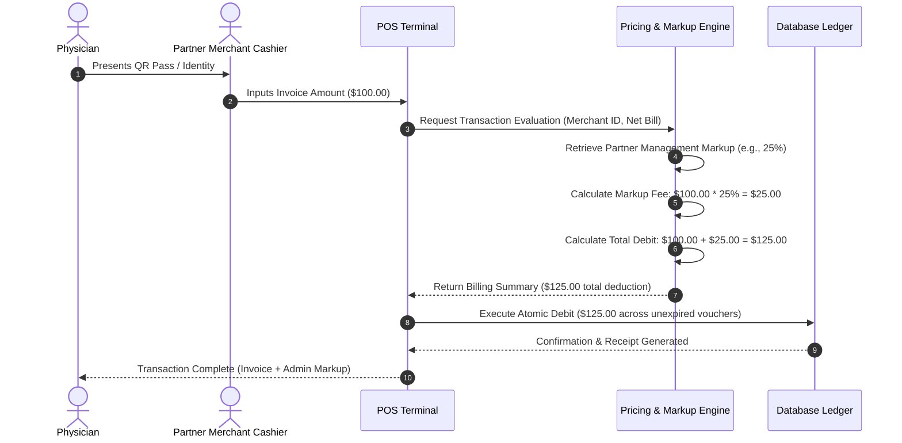
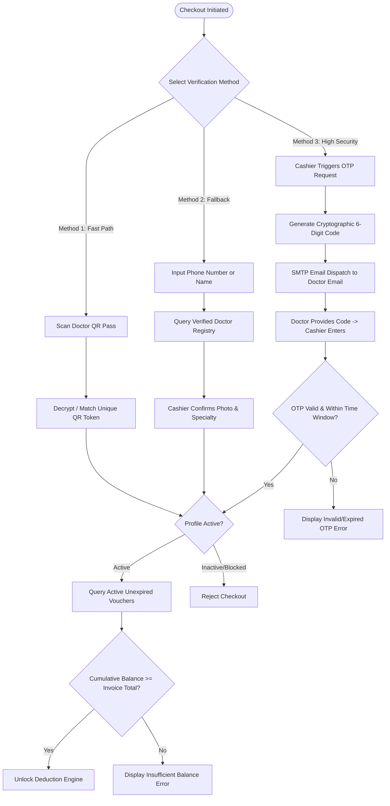

# System Architecture & Technical Blueprint

This document details the architectural design, component layers, security controls, and operational topology of the **Vaetcher** platform. 

The architecture is engineered as a modular, high-reliability enterprise application serving a hospitality client ("a restaurant client" / "Vendor X") to manage corporate-sponsored medical dining vouchers and multi-party financial settlements.

---

## 1. High-Level Architectural Blueprint

The platform follows a clean **Three-Tier Modular Architecture** combining server-rendered presentation, domain-driven business logic, and relational data persistence.

```mermaid
flowchart TD
    subgraph Presentation_Layer["1. Presentation & Interaction Layer"]
        UI_Admin["Vendor Admin Portal\n(Management, Markups, Settlements)"]
        UI_Vendor["Vendor / Trader Dashboard\n(Sales, Cashiers, Net Balance)"]
        UI_Cashier["POS Checkout Terminal\n(QR Scanner, Search, OTP Input)"]
        UI_Doctor["Doctor Mobile Portal\n(Balance, QR Pass, P2P Transfer)"]
        UI_Company["Pharma Sponsor Portal\n(Event Budgets & Reconciliations)"]
        UI_Delegate["Medical Delegate Portal\n(Event Rosters & Commission Pay)"]
        Templates["Server-Rendered Template Engine\n(Django Templates, Bilingual i18n, RTL/LTR)"]
    end

    subgraph Domain_Services_Layer["2. Business Logic & Core Domain Services"]
        AuthService["Identity & RBAC Engine\n(Role Enforcement, Hierarchical Vendors)"]
        VoucherEngine["Voucher & Balance Engine\n(Waterfall Allocation, Expiry Guards)"]
        VerificationEngine["Tri-Factor POS Verification\n(QR Token, Directory Search, Email OTP)"]
        MarkupEngine["Dynamic Pricing & Markup Engine\n(Partner Commission, Tax/Service Calc)"]
        SettlementEngine["Triple-Tier Settlement Engines\n(Vendor, Company, Delegate)"]
        NotificationEngine["Notification & Mail Engine\n(Real-Time Email Logs, Dynamic OTP)"]
    end

    subgraph Persistence_Layer["3. Data Persistence & Storage Layer"]
        DB_Relational[("Relational Database\n(Atomic Transactions, Constraints, Indexes)")]
        Media_Storage["Document & Media Store\n(Settlement Receipts, Doctor Passes, Logos)"]
    end

    Presentation_Layer --> Domain_Services_Layer
    Domain_Services_Layer --> Persistence_Layer
```



---

## 2. Layered Architecture Breakdown

### 2.1. Presentation Layer (Server-Side Rendering & Localization)
- **Technology Strategy:** Employs Django server-side rendered templates rather than decoupled single-page application (SPA) frameworks.
- **Architectural Rationale:** 
  - Direct template rendering eliminates client-side state synchronization errors and API payload overhead during high-speed checkout operations.
  - Guarantees instant page loads on low-power register terminals and mobile devices without requiring client-side JavaScript compilation.
- **Bilingual & RTL Ergonomics:**
  - Comprehensive internationalization (i18n) engine supporting **Arabic** and **English**.
  - Native Right-to-Left (RTL) stylesheets engineered specifically for Arabic-speaking operations staff and field representatives, with seamless bidirectional flipping for English corporate reports.

---

### 2.2. Domain Services Layer (Core Engines)

#### A. Identity & Role-Based Access Control (RBAC) Engine
- Enforces strict operational boundaries across six authenticated stakeholder personas.
- Implements a hierarchical merchant-cashier structure: parent merchants manage branch metadata while cashier sub-accounts are restricted to transaction logging.

#### B. Voucher & Balance Lifecycle Engine
- Governs balance updates and invariant enforcement.
- Implements **Waterfall Allocation**: when an invoice amount exceeds a single voucher's available balance, the engine automatically splits deductions across multiple unexpired vouchers held by the doctor, exhausting the oldest expiring voucher first.
- Rejects any transaction attempt against expired vouchers ($CurrentDate > ExpiryDate$).

#### C. Tri-Factor POS Verification Engine
Coordinates multi-channel customer validation before checkout authorization:
1. **QR Token Resolver:** Resolves unique alphanumeric hash tokens to verified doctor accounts within milliseconds.
2. **Directory Search Provider:** Performs normalized phone and name matching for forgot-phone workflows.
3. **Email OTP Dispatcher:** Generates time-bound, cryptographically random numeric verification codes delivered through real-time SMTP dispatch.

#### D. Dynamic Pricing & Markup Engine
- Automatically differentiates between primary venue redemptions and third-party partner merchant ("Trader") transactions.
- Injects configurable merchant markup percentages ($ManagementFee\%$) into partner invoices, calculating administrative fees and final debit totals in real time.

#### E. Triple-Tier Settlement Engine
Manages three mathematically isolated financial reconciliation pipelines:
1. **Vendor Settlement:** Reconciles gross partner sales, administrative markups, and net payouts, validating against historical available balances.
2. **Company Settlement:** Reconciles corporate sponsor budget limits against distributed voucher values and actual dining consumption.
3. **Delegate Settlement:** Computes performance-based sales commissions based on assigned seminar counts and attending doctor headcounts.

---

### 2.3. Data Persistence & Consistency Layer
- **ACID Transaction Boundaries:** All point-of-sale balance deductions and peer-to-peer balance transfers execute within isolated database transactions.
- **Pessimistic Concurrency Controls:** Selected doctor and voucher records are locked during transaction execution to prevent double-spending race conditions.
- **Audit Trails & Soft Deletion:** Critical financial records (companies, merchants, doctors, vouchers, transactions) utilize soft-deletion flags, ensuring historical audit trails remain permanently queryable.

---

## 3. Stakeholder Dashboard & Access Boundary Topology

```mermaid
graph TD
    User([Incoming User Request]) --> AuthGateway{Authentication & Role Check}

    AuthGateway -->|Role: ADMIN| AdminDashboard[Vendor Admin Portal]
    AuthGateway -->|Role: VENDOR (Admin)| VendorDashboard[Merchant Portal]
    AuthGateway -->|Role: VENDOR (Cashier)| CashierTerminal[POS Register Terminal]
    AuthGateway -->|Role: COMPANY| CompanyPortal[Pharma Corporate Portal]
    AuthGateway -->|Role: DELEGATE| DelegatePortal[Representative Portal]
    AuthGateway -->|Role: DOCTOR| DoctorPortal[Physician Mobile Pass]

    subgraph Admin_Domain["Administrative Scope"]
        AdminDashboard --> ManagePartners[Partner Merchant Onboarding & Markups]
        AdminDashboard --> ManageEvents[Seminar Approvals & Budget Caps]
        AdminDashboard --> ExecVendorSettlement[Vendor Settlement Execution]
        AdminDashboard --> SystemAudit[Global Sales & Solvency Audits]
    end

    subgraph Vendor_Domain["Merchant Scope"]
        VendorDashboard --> ViewSales[Real-Time Sales & Fees]
        VendorDashboard --> ManageCashiers[Provision Branch Cashiers]
        VendorDashboard --> TrackPayouts[Settlement Inquiries]
    end

    subgraph Cashier_Domain["POS Scope"]
        CashierTerminal --> ScanQR[Scan Doctor QR Pass]
        CashierTerminal --> SearchDoctor[Directory Phone/Name Lookup]
        CashierTerminal --> TriggerOTP[Dispatch & Verify Email OTP]
        CashierTerminal --> ProcessPayment[Instant Atomic Deduction]
    end

    subgraph Corporate_Domain["Sponsor Scope"]
        CompanyPortal --> SubmitEvent[Request Seminar & Budget Allocation]
        CompanyPortal --> CompanyReconciliation[Corporate Budget Settlement]
    end

    subgraph Delegate_Domain["Field Scope"]
        DelegatePortal --> ManageRosters[Manage Doctor Invitations]
        DelegatePortal --> TrackCommissions[Delegate Settlement Review]
    end

    subgraph Doctor_Domain["Customer Scope"]
        DoctorPortal --> ViewBalance[View Active Balances & Timers]
        DoctorPortal --> ShowQR[Display Dynamic QR Pass]
        DoctorPortal --> P2PTransfer[Transfer Balance to Colleague]
    end
```

---

## 4. Role-Based Access Control (RBAC) Matrix

| Operational Capability | Vendor Admin | Vendor (Merchant) | Vendor Cashier | Pharma Company | Medical Delegate | Doctor |
| :--- | :---: | :---: | :---: | :---: | :---: | :---: |
| **System Configuration & Markups** | **Full** | None | None | None | None | None |
| **Approve Seminar Requests** | **Full** | None | None | None | None | None |
| **Execute Vendor Settlements** | **Full** | View (Own) | None | None | None | None |
| **Manage Cashier Accounts** | **Full** | **Full (Own)** | None | None | None | None |
| **Point-of-Sale Checkout & Scan** | None | None | **Full** | None | None | None |
| **Request Seminar Sponsorship** | View | None | None | **Full** | Submit | None |
| **Reconcile Corporate Budget** | View / Close | None | None | **Full** | None | None |
| **Review Delegate Commissions** | View / Close | None | None | None | **Full** | None |
| **View Personal Voucher Balance** | None | None | None | None | None | **Full** |
| **Transfer Voucher Balance** | None | None | None | None | None | **Full** |

---

## 5. Partner Merchant Network & Markup Routing Architecture

When the primary venue expands operations by contracting external partner merchants (Traders), transactions follow a specialized pricing and settlement pipeline:



### Settlement Reconciliation Formula:
At monthly settlement, the primary venue reconciles accounts with the partner merchant:
- **Total Gross Sales:** $\$100.00$ (disbursable to merchant)
- **Administrative Markup Retained:** $\$25.00$ (earned revenue for primary venue)
- **Total Voucher Value Debited:** $\$125.00$ (funded by corporate sponsorship)

---

## 6. Point-of-Sale Tri-Factor Verification Topology



---

## 7. Deployment & Operational Topology

- **Single-Client Architecture:** The platform is deployed as a dedicated single-tenant instance serving the client venue and its connected merchant network.
- **Execution Environment:** Configured for high-efficiency local server execution without cloud dependencies or container orchestration overhead, optimizing for responsiveness in on-premise local networks.
- **Media Asset Storage:** Encrypted local file storage for settlement sign-off receipts, cashier logos, and doctor profile photos.
- **Relational Integrity:** Backed by a transactional SQL storage engine ensuring strict ACID compliance during concurrent checkouts.
