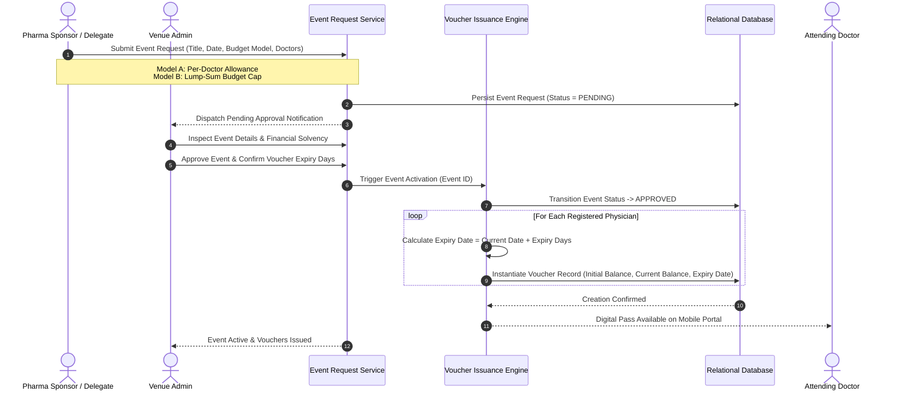
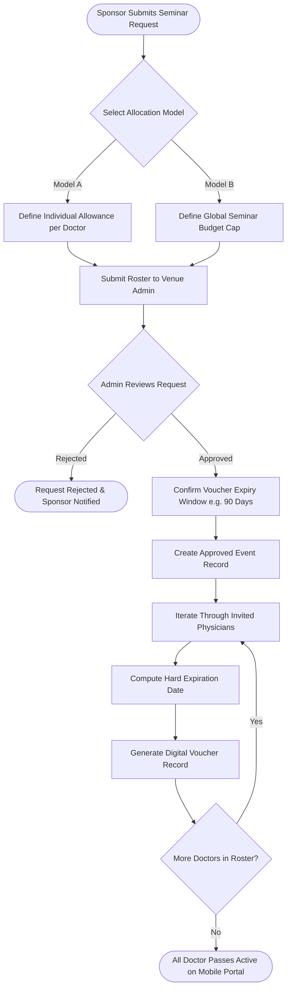
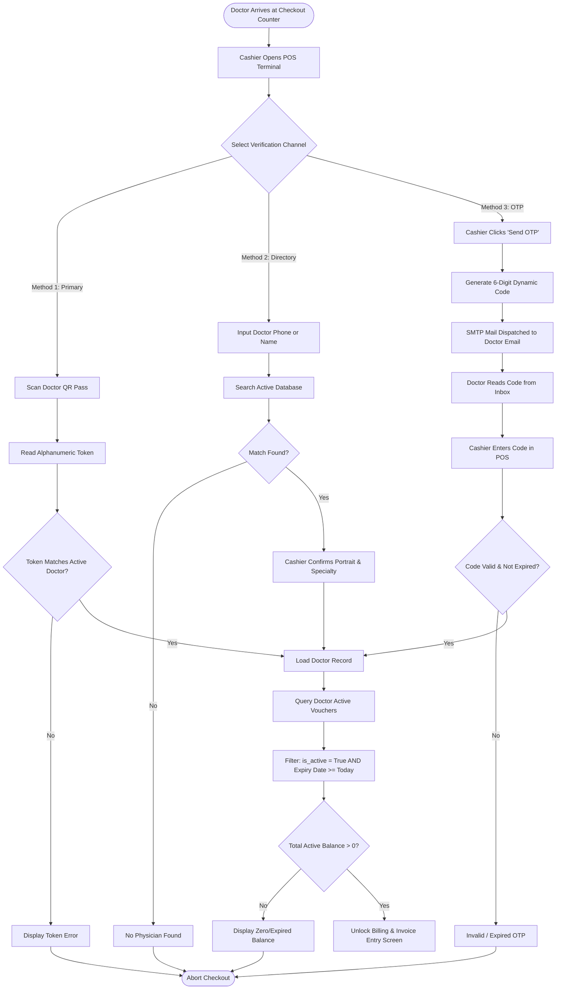
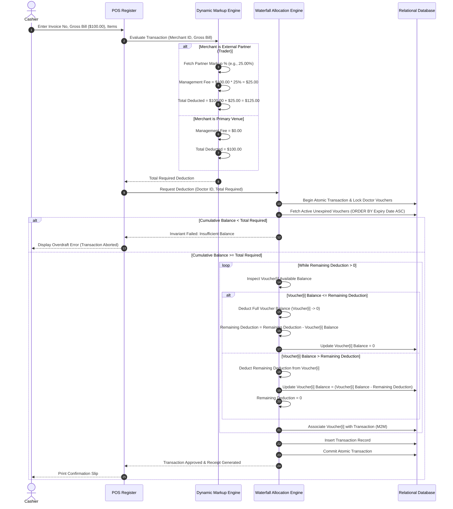
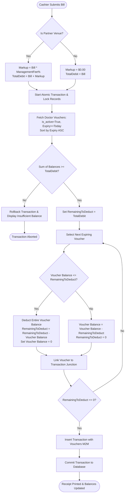
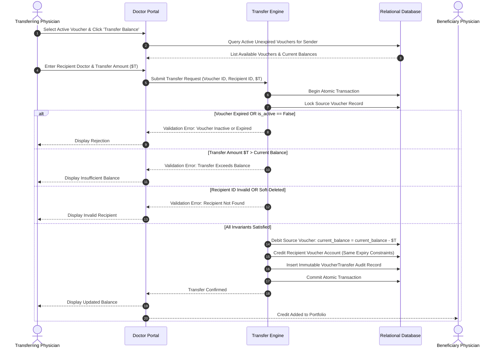
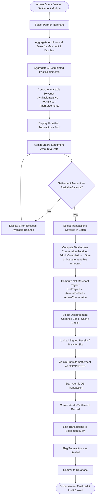
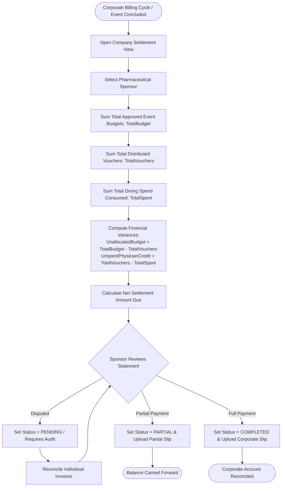

# Operational Workflows & Engineering Flowcharts

This document details the operational workflows, business process flowcharts, activity diagrams, and sequence diagrams governing the **Vaetcher** platform. 

Every diagram is derived from production-validated business logic, illustrating end-to-end interactions between physicians, cashiers, venue administrators, corporate sponsors, and financial settlement engines.

---

## 1. Workflow 1: Medical Seminar Sponsorship & Voucher Generation

This workflow details how a pharmaceutical sponsor initiates a medical seminar, allocates attendee budgets, gains venue approval, and triggers automatic digital voucher creation.

### 1.1. Sequence Diagram


### 1.2. Process Flowchart


---

## 2. Workflow 2: POS Checkout & Tri-Factor Verification

Illustrates the cashier point-of-sale workflow for validating a physician's identity via one of three available verification pathways before unlocking invoice entry.



---

## 3. Workflow 3: Multi-Voucher Waterfall Deduction & Partner Markup Engine

This diagram outlines the core atomic calculation executed when an invoice is submitted, demonstrating the Many-to-Many deduction model across multiple vouchers and dynamic partner markups.

### 3.1. Waterfall Deduction Sequence Diagram


### 3.2. Algorithmic Flowchart


---

## 4. Workflow 4: Peer-to-Peer Voucher Balance Transfer

Governs the delegation of dining allowances between attending physicians, enforcing ownership, balance limits, and chronological expiration inheritance.



---

## 5. Workflow 5: Vendor Settlement End-to-End Reconciliation

Details how venue administrators close financial periods with partner dining merchants (Traders), deducting administrative management fees and enforcing balance invariants.



---

## 6. Workflow 6: Pharmaceutical Company Budget Settlement

Governs the corporate reconciliation between sponsoring pharmaceutical firms and the hospitality venue, calculating budget utilization and surplus credits.



---

## 7. Workflow 7: Medical Delegate Commission Settlement

Details the commission calculation and payout authorization for field representatives coordinating scientific seminars.

```mermaid
flowchart TD
    StartDelegate([Representative Commission Review]) --> SelectDelegate[Select Medical Sales Delegate]
    SelectDelegate --> SelectSponsor[Select Associated Pharma Sponsor]

    SelectSponsor --> AggregateEvents[Count Completed Events Assigned]
    AggregateEvents --> AggregateDoctors[Count Registered Attending Physicians]
    AggregateDoctors --> GetRate[Retrieve Contracted Commission Rate %]

    GetRate --> ComputeCommission[Calculate Performance Remuneration:<br/>TotalCommission = Formula(Events, Doctors, CommissionRate)]

    ComputeCommission --> AdminDelegateReview{Review Performance Metrics}
    AdminDelegateReview -->|Dispute| FlagDisputed[Set Status = DISPUTED / Under Review] --> TerminateReview([Hold Payout])
    AdminDelegateReview -->|Approved| EnterPayout[Set Settlement Amount & Date]
    EnterPayout --> AttachSlip[Upload Payment Voucher / Receipt]
    AttachSlip --> SetCompleted[Transition Status to COMPLETED]
    SetCompleted --> DelegatePaid([Delegate Remuneration Disbursed])
```
